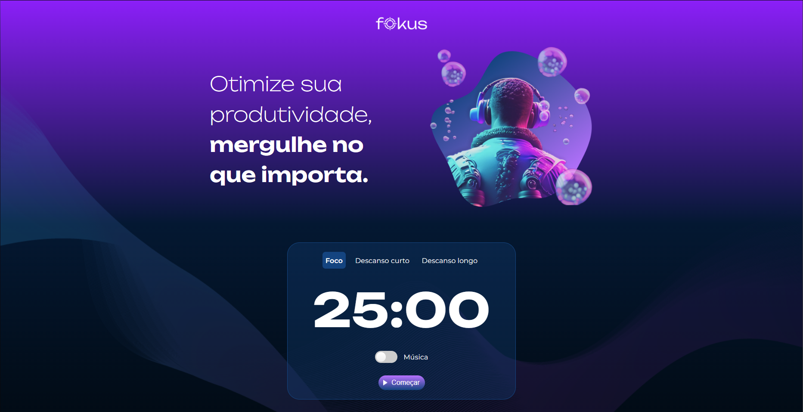

# ⏳ FOKUS  

O <strong>Fokus</strong> é uma aplicação desenvolvida para auxiliar na produtividade e na organização dos estudos e tarefas, utilizando como base a técnica Pomodoro. A ferramenta permite alternar entre períodos de concentração e descanso, proporcionando uma rotina mais equilibrada e eficiente. Com uma interface intuitiva e temática, o projeto oferece diferentes modos de temporização para ajudar a manter o foco e otimizar o tempo.

   

### ⚙ Tecnologias Utilizadas

  
  
  

### ✔️ Funcionalidades

- ⏱️ **Temporizador Pomodoro**: Contagem regressiva para períodos de foco, descanso curto e descanso longo.
- 🔄 **Alternância de períodos**: Permite alternar entre os três modos de temporização.
- 🎨 **Interface dinâmica**: Elementos visuais, cores, imagens e mensagens de acordo com o período selecionado.
- 🎵 **Controle de música**: Opção para ativar ou desativar uma música calma durante as sessões.
- ▶️ **Controle do temporizador**: Permite iniciar e pausar a contagem regressiva de cada período.
- 📱 **Design responsivo**: Interface adaptável a diferentes tamanhos de tela.

### 🌐 Como Acessar ?

1. Clone este repositório para sua máquina local.
2. Abra o arquivo `index.html` em seu navegador web.
3. Ou, [Clique aqui](https://fokuspomodoro-five.vercel.app).
4. Aproveite sua sessão de foco!
